# Javim Medical Consultants Limited

A minimalist, responsive laboratory website built with Vite, vanilla JavaScript and Three.js. Figtree and DM Mono are bundled locally, without external font requests.

## Current design

### Page loading and motion

Homepage and services introductions have subtle entrance animations; selected homepage sections reveal once as they enter the viewport. Reduced-motion preferences disable these effects. Content is visible by default, including when animation APIs are unavailable. The DNA canvas fades in after its first rendered frame; no placeholder drawing is shown during loading. If WebGL fails, a static capture of the real 3D scene is displayed from `public/assets/dna-poster.webp`.

Catalogue departments behave as an exclusive accordion, including after searches and filter changes. Searches retain all matching tests and initially open the first matching department.

### Individual test guidance

All 42 tests include a “Before your test” card, with Before / During / After sections and a test-specific WhatsApp enquiry. Hover or keyboard focus previews the card; click pins it open. Escape dismisses it. Mobile uses a stacked expandable card, and only one guidance card stays open at a time. Event delegation keeps the behaviour working after catalogue search and filter updates.

Content is general educational guidance, not lab-approved operational instructions. Javim must confirm preparation, specimen handling, pricing, turnaround and any external testing. Medicines are never presented as something to stop without clinical advice. Test-specific copy is maintained in `src/test-guidance.js` for review and updates.

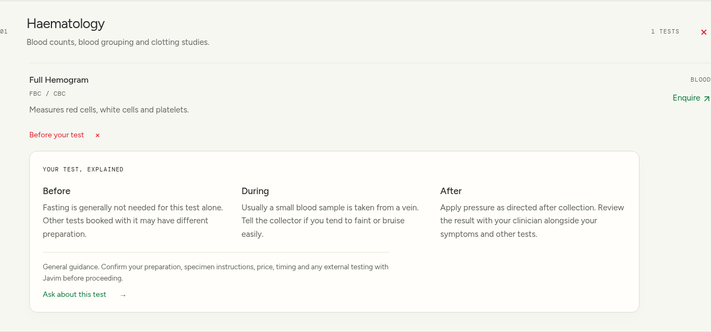

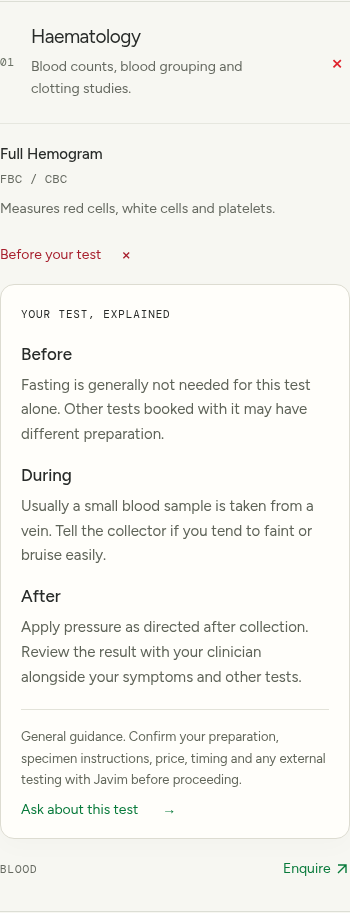

### Services-page blood cells

A transparent, lazy-loaded Three.js scene sits beside “Find your next answer.” Eight biconcave cells (five on mobile) use high-resolution membrane geometry, fine procedural bump texture, studio lighting and independent slow drifting/rotation. A dense layer of GPU-shaded surface grains adds visible relief: 69,000 on desktop and 26,000 on mobile. These use sphere-impostor points attached to the membranes, not billions of simulated particles. Lower gloss keeps the surfaces granular. Pointer movement gently changes the viewing angle. This is a conceptual scientific rendering, not a clinical micrograph or a physically simulated bloodstream.

The animation pauses off-screen and when the tab is hidden. A pause/play control is available; reduced-motion preferences start the scene paused. WebGL failure retains the existing static blood-cell illustration and leaves catalogue search usable.

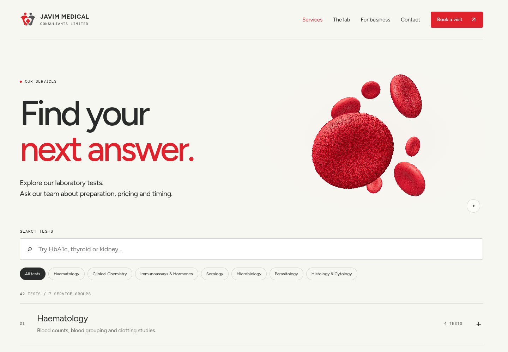

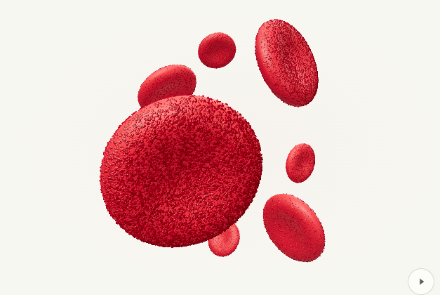

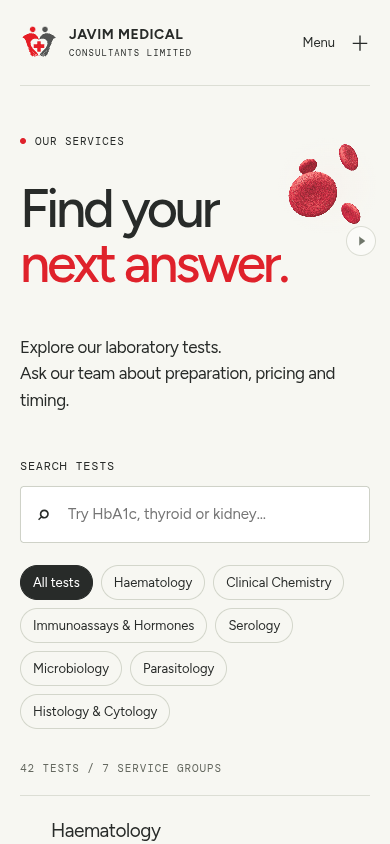

### Interactive testing journey

The former three principles are now a user-controlled process: Enquire → Arrange your sample → Testing & results. Selecting a step changes the illustration, explanation and action. Enquiry and results actions open WhatsApp; sample arrangements open the existing booking choices. Arrow keys, Home and End navigate the tabs. External-laboratory arrangements are framed as information to confirm during enquiry, with no promise that every test is performed on-site.

These three images are AI-generated conceptual scenes, not photographs of Javim staff, equipment or premises. Responsive WebP copies are stored locally in `public/assets/process`.

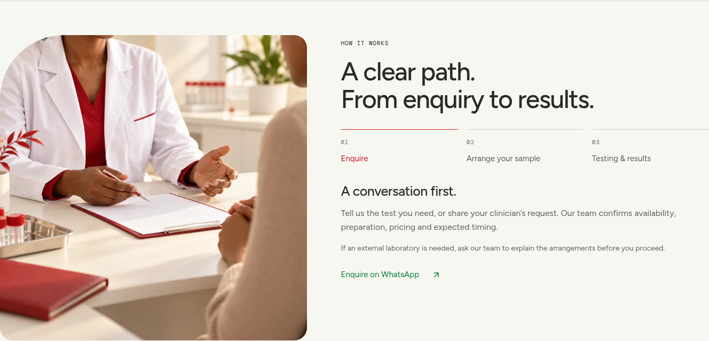

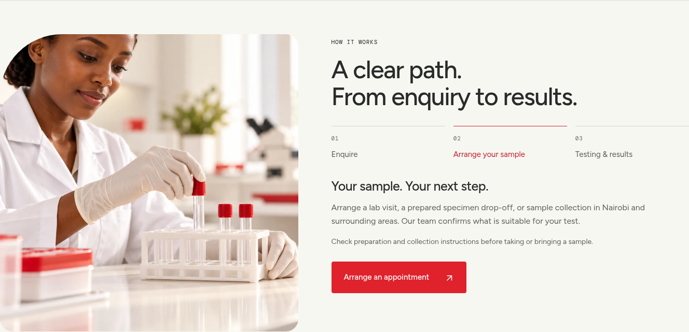

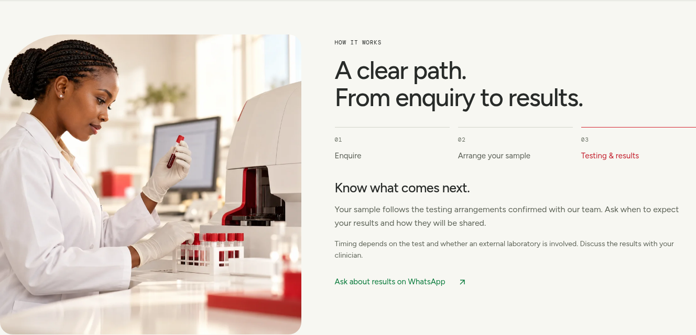

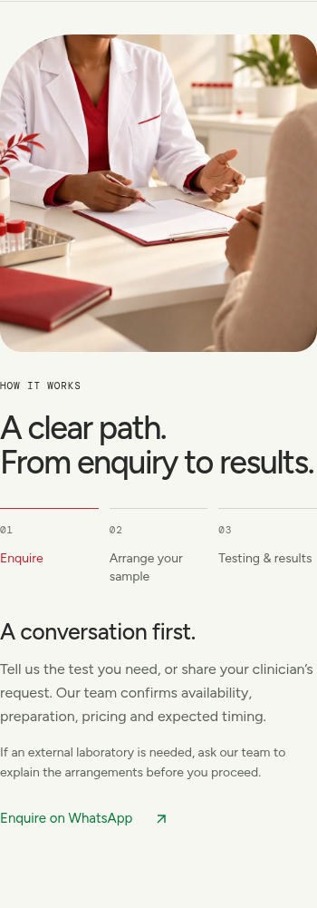

### Service discovery cards

Seven categories in a fixed 3–3–1 desktop layout. Selecting a card opens a 480 px right-side dialog, with an image, three test previews and a link to the full category. The grid stays in place. A category selector updates the same panel. Close using the button, Escape or the backdrop; focus returns to the opening card. The panel is full-width on mobile. Its slide-and-fade animation respects reduced-motion preferences.

The seven images are AI-generated conceptual illustrations, not diagnostic micrographs. Responsive lazy-loaded WebP assets live in `public/assets/services`; the complete two-size set is approximately 500 KB. The full catalogue retains all 42 tests.

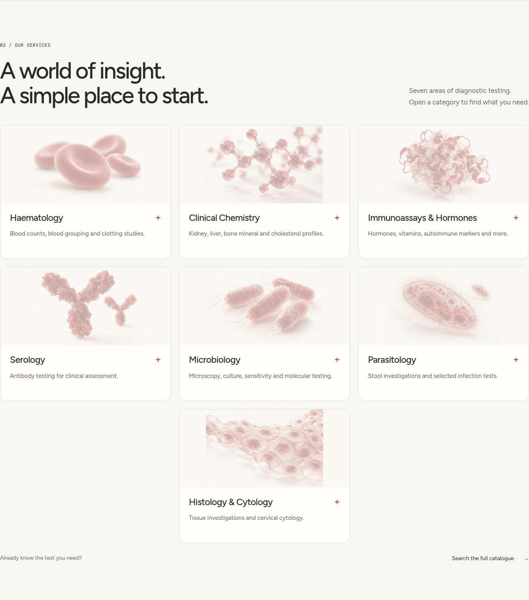

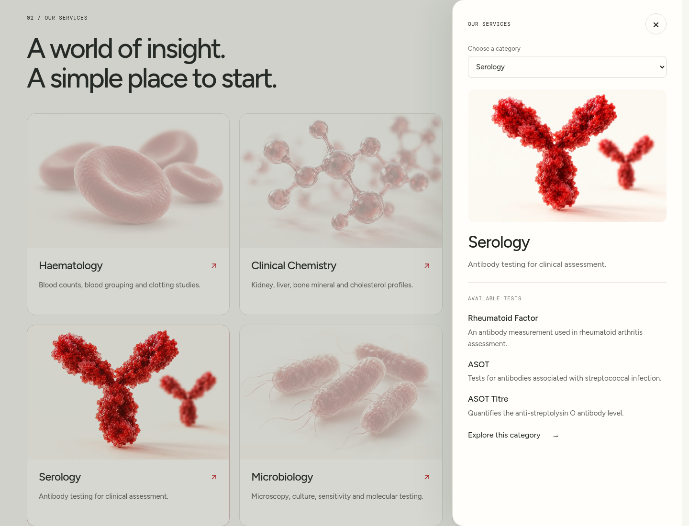

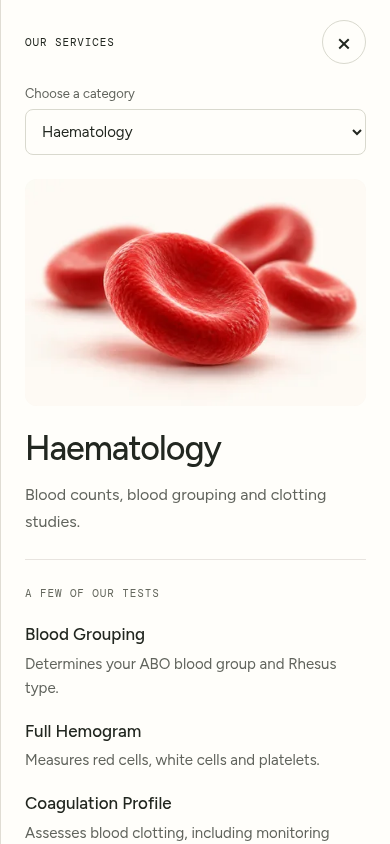


Screenshots of the current implementation. The landing-page DNA scene is paused in these captures. Its transparent canvas lets the light page background show through.

### Desktop homepage

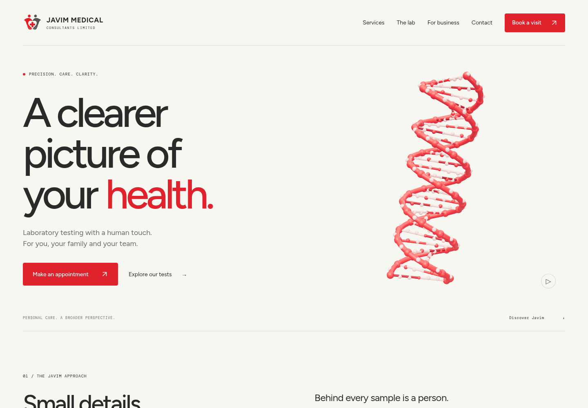

[View the complete homepage](docs/screenshots/homepage.png)

### Mobile homepage

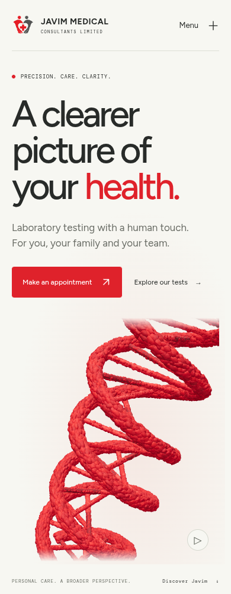

### DNA scene

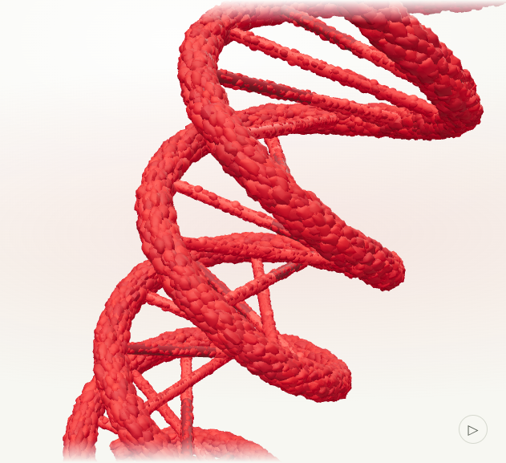

### Flowing particle phase

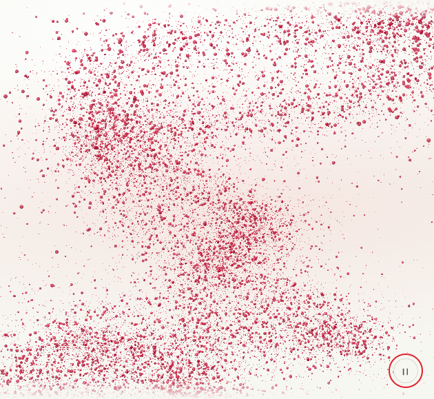

### Interactive anatomy explorer

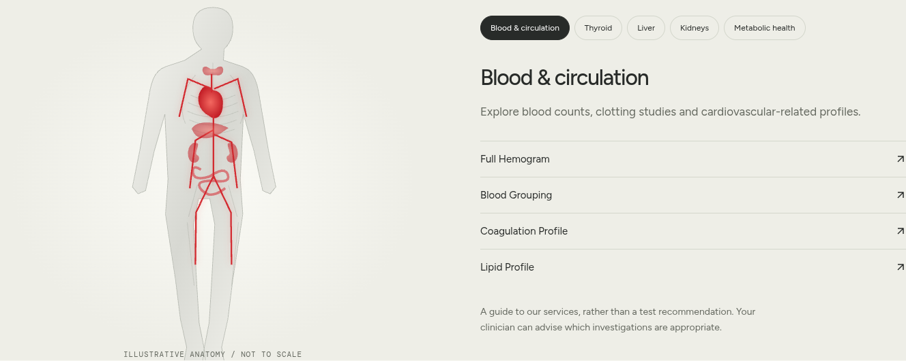

### Organ close-up

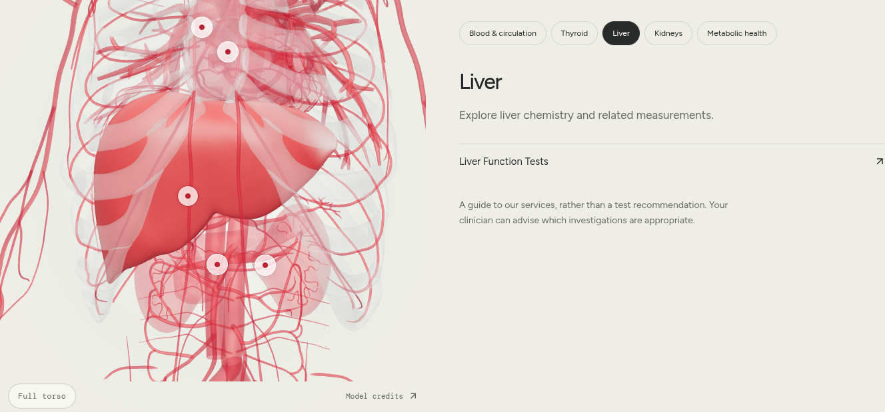

### Mobile anatomy

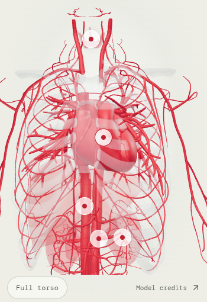

### Services catalogue

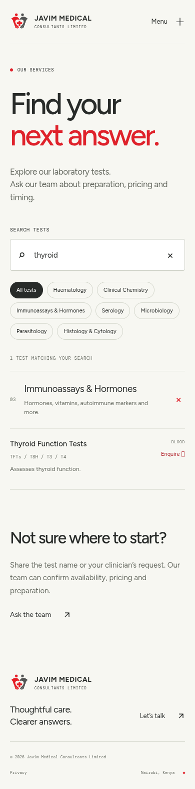

### Booking options

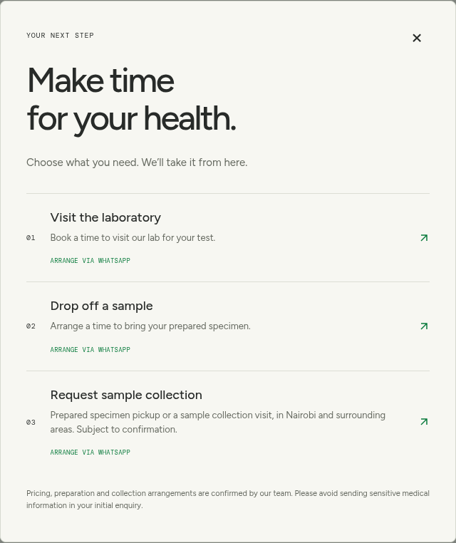

## Development

Use the existing checkout at `/workspace/Javim-Medical-Consulting`. Cloud tasks are isolated; a separate Git worktree is unnecessary.

```sh
npm ci --cache /tmp/javim-npm-cache
npm run dev -- --port 5173
```

Node 22.12+ or 24 is supported. `npm run build` creates `dist/`; `npm run preview -- --port 4173` serves the production build. The host must serve `index.html` for `/services` and `/privacy`. Vercel rewrites are included.

## Structure and content

- `/`: homepage, expandable service categories, expandable body-system explorer, company/corporate content and contact details.
- `/services`: 42 tests in seven categories, text/alias search and department filtering. Anatomy links prefill the search.
- `/privacy`: website privacy notice. The laboratory's own patient-data policy still needs to be supplied and reviewed before launch.
- `src/data.js`: catalogue, contact information, body-system mappings and booking configuration.
- `src/scene.js`: live blood-cell and DNA scenes. The animation module loads only on the homepage.
- `public/assets/`: logo and favicon.

Unverified business statistics, outsourcing claims, instant-result claims and clinical promises from the supplied copy have been removed. The source labels a Salmonella antigen test as “Widal”; these are different methods, so the display uses “Typhoid Testing” and asks the lab to confirm its method. Have the owner/clinical team review test descriptions before publication.

## Booking

WhatsApp booking works using the confirmed number. Three options are presented: lab visit, prepared-specimen drop-off, and sample collection request. Collection includes both prepared-specimen pickup and visits to collect samples in Nairobi and surrounding areas, subject to team confirmation.

Once public Cal.com event links exist, copy `.env.example` to `.env.local` and fill the matching `VITE_CAL_*_URL` fields. Restart the development server or rebuild. Only HTTPS links on `cal.com` or its subdomains are accepted; empty/invalid links retain the WhatsApp fallback. Links are public settings, never credentials. Cal.com scheduling is not verified until real events are provided. Configure collection-event availability and confirmation to match the lab's actual operations.

## Visual assets and limitations

The supplied logo images were visible in the conversation but were not available as local downloadable files, and retrieval from the former website was blocked. The current mark is a hand-recreated SVG based on the supplied artwork, not the original vector. Replace `public/assets/javim-mark.svg` and `favicon.svg` with approved originals for launch.

The landing-page visual starts as a thin red helix leaning right, then automatically dissolves into coherent curling streams of grain and droplet particles before reforming. The 24-second cycle rests intact for four seconds, dissolves over five seconds, flows for seven seconds, reforms over six seconds and rests again. GPU shaders animate 32,000 particles on desktop and 14,000 on mobile; they suggest a dense liquid cloud without attempting to render billions of objects. Moving a pointer or deliberately dragging on touch repels and swirls nearby particles in the fluid phase. Touch uses `pan-y` so vertical page scrolling remains available. The effect is an illustrative liquid-like particle flow, not a physically exact fluid simulation.

The canvas remains transparent over the softly lit hero, with pause, reduced-motion, off-screen suspension and a static fallback. Reduced motion starts with intact, still DNA; pressing Play opts into animation. Particle positions are calculated from their original DNA coordinates, so the scene continuously reforms without accumulating drift. This is a scientific illustration, not a claim that Javim offers genetic testing. WhatsApp text and links retain accessible brand-green colours.

The anatomy explorer now uses a real 3D torso with selected atlas-derived heart chambers, vessels, ribs, clavicles, sternum, thyroid, liver and pancreas. The browser asset is approximately 3.9 MB with Meshopt compression and loads only when the explorer opens. Organ markers and the system buttons highlight the selected structures, focus the camera and reveal the existing related tests. Drag to rotate and use “Full torso” to restore the overview. The cropped SVG remains as a fallback when WebGL or the asset is unavailable.

Model attribution and ShareAlike terms are available through the visible **Model credits** link and `public/assets/anatomy/NOTICE.md`. The atlas's noncommercial kidney and inner-ear meshes are excluded; kidneys are independently authored simplified shapes. This remains a service-discovery illustration, not a clinical anatomy reference or a diagnostic recommendation. Have the clinical team review organ presentation and test associations before medical-instruction use.

### Reproducing the anatomy asset

The checked-in GLB is ready to serve; Blender and conversion packages are **not** needed for normal website development. To rebuild it, obtain the exact source revision documented in `NOTICE.md`, extract only `Z-Anatomy/Startup.blend` from the source archive, and run Blender with scripts disabled:

```sh
blender --background --disable-autoexec /path/to/Startup.blend --python tools/export-anatomy.py
npm install --prefix /tmp/javim-model-tools @gltf-transform/core @gltf-transform/extensions @gltf-transform/functions meshoptimizer --cache /tmp/javim-npm-cache
cp tools/optimize-anatomy.mjs /tmp/javim-model-tools/optimize.mjs
node /tmp/javim-model-tools/optimize.mjs public/assets/anatomy/torso.glb /tmp/javim-torso-optimized.glb
cp /tmp/javim-torso-optimized.glb public/assets/anatomy/torso.glb
```

The conversion scripts perform the selection, crop, smoothing, original kidney construction, simplification and compression. The model manifest records included structures; the asset licence applies to the adapted model, not unrelated website code.

## Validation

```sh
npm test
npm run build
# With the development server running:
npx playwright test
```

Browser tests use `/usr/bin/chromium` in this environment. Set `CHROMIUM_PATH` if installed elsewhere. Test coverage includes catalogue aliases/counts, anatomical service mappings, booking URLs, scene controls, modal dismissal, mobile navigation, reduced motion, search input safety, WebGL fallback and automated WCAG accessibility scans.

No backend or patient records are stored by this app. WhatsApp, Cal.com and Maps are external services. Deployment/publication is a separate step.
