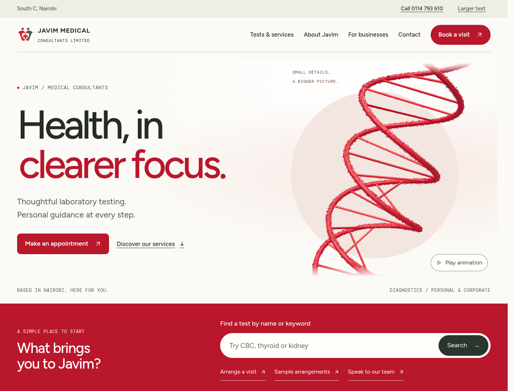
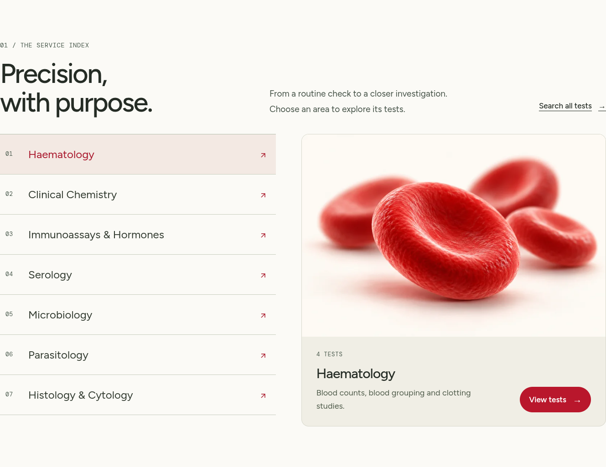
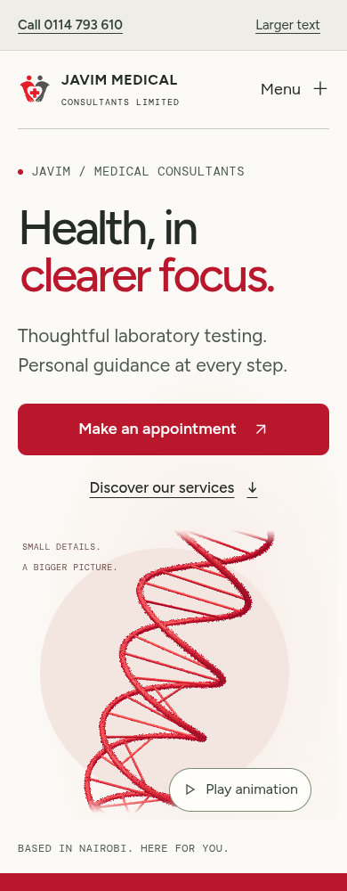

# Design 02 — In Focus

A fresh visual variation of Javim, on `design/clear-care`. This replaces the early Clear Care styling. Design 01 on `main` and the existing Design 03 branch are unchanged.

The direction pairs oversized editorial typography with the retained red scientific imagery, a pale sculptural backdrop for the live DNA and a strong red band for search and appointment actions. Warm white, charcoal, brand red and deep WhatsApp green remain the palette.

The homepage now leads from its introduction into search and a service index. Seven category buttons update one large image and summary, with a single action opening the matching test panel. On mobile, selecting a category brings the preview into view. The full catalogue keeps all 42 tests, exclusive category accordions and Before / During / After guidance.

The process section, anatomy explorer, business enquiry and contact details are retained in a new composition. Larger-text controls, labelled animation controls, opt-in 3D movement, keyboard focus and reduced-motion behaviour remain supported.

## Preview

[Complete homepage](screenshots/design-02/home-full.png) · [Complete mobile homepage](screenshots/design-02/mobile-full.png) · [Services page](screenshots/design-02/services.png)

## Review notes

All contact details and test information are retained. No new claims of accreditation, overseas locations or exclusive in-house testing have been added. The existing generated images remain conceptual illustrations rather than photographs of Javim premises or personnel. Cal.com links can be configured when the account is ready; booking otherwise uses the confirmed WhatsApp contact.

The production build passed. Category/image selection, matching service details, homepage search and the process/booking flow were verified. Layout bounds passed at 1440, 720, 390 and 320 pixels with larger text enabled. Automated WCAG A/AA scans passed on the homepage, catalogue with expanded test guidance, privacy and the open service panel. These do not replace review with real users or establish complete accessibility compliance.
