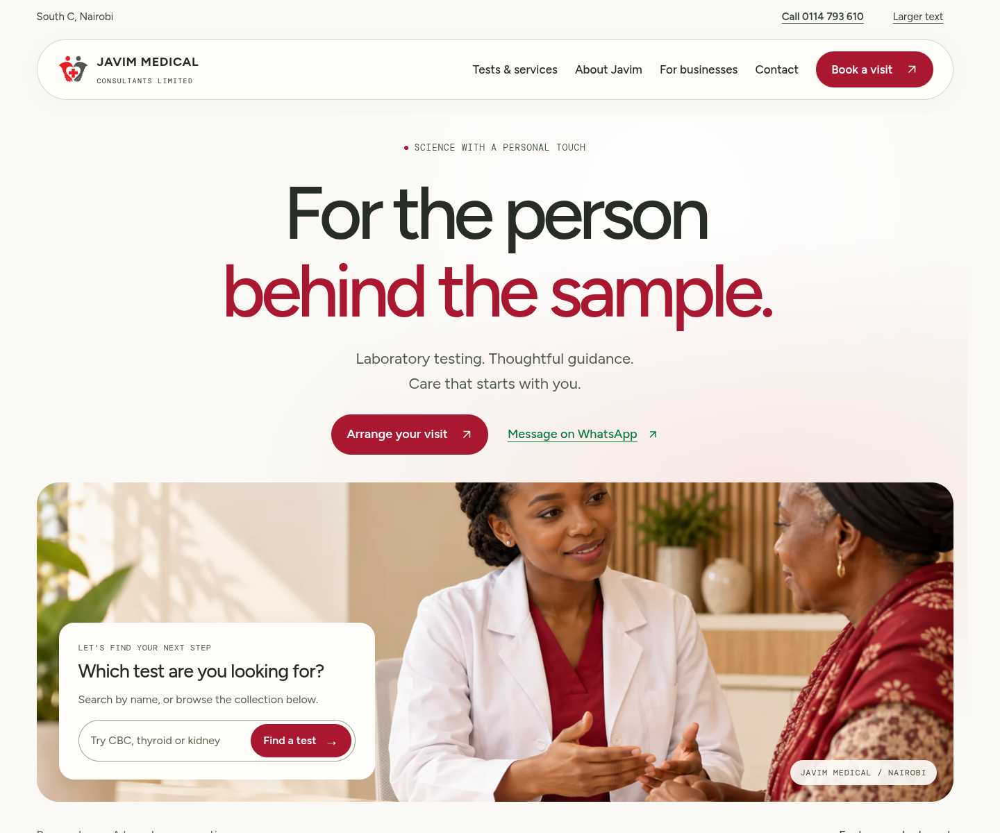
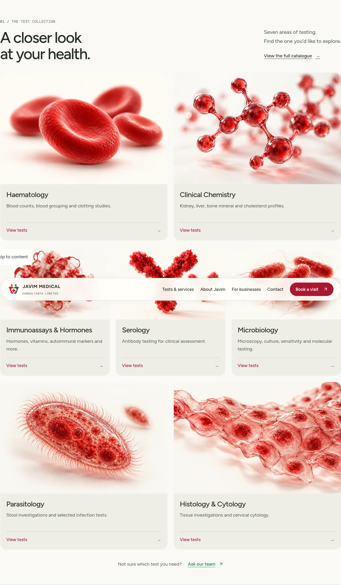
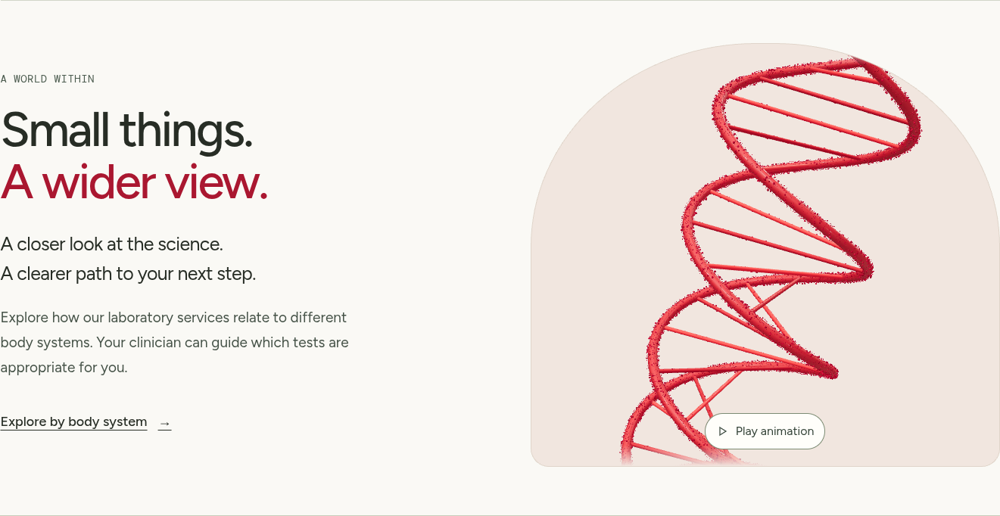
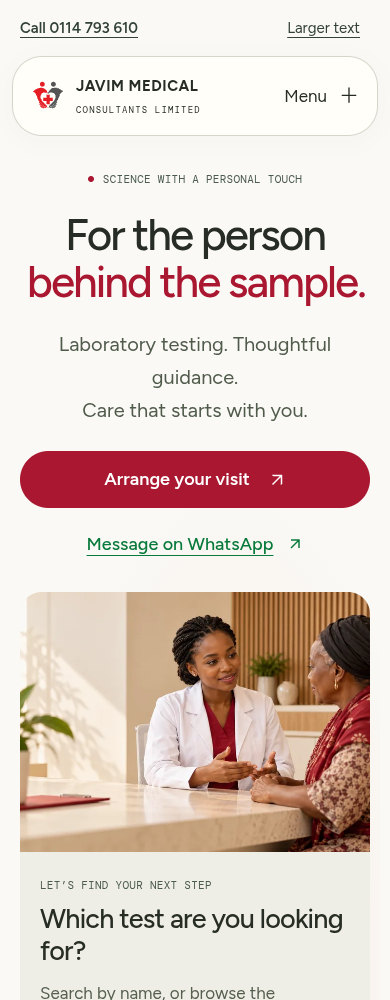

# Design 03 — Human, by Nature

A distinct visual variation on `design/guided-care`, replacing the early Guided Care layout. Design 01 (`main`) and Design 02 (`design/clear-care`) are unchanged.

## Direction

The page opens with a centered editorial introduction and a broad consultation illustration. A floating pill-shaped navigation bar, rounded image frames, a photographic service gallery, and a red-and-white contact section establish a different rhythm from Design 02’s service index and search band.

The retained DNA animation has its own “A world within” section, rather than leading the homepage. The anatomy explorer, process imagery, blood-cell scene on the catalogue page and general test guidance remain available.

## Functionality

- Homepage test search submits directly to the full catalogue.
- Seven visual category cards open the matching service detail panel.
- Appointment actions open the existing visit, drop-off and collection choices.
- Visible phone and WhatsApp actions provide direct contact.
- Larger-text preference, keyboard navigation, visible focus, reduced-motion support and opt-in scientific animations are retained.
- Images retain their full 3:2 composition in the gallery. On mobile, the overlaid search card moves below the hero photograph so text stays legible.

## Screenshots

[Full homepage](screenshots/design-03/home-full.png) · [Full mobile homepage](screenshots/design-03/mobile-full.png) · [Catalogue](screenshots/design-03/catalogue.png)

## Content and review

The new consultation image is AI-generated and illustrative, not a photograph of Javim staff, patients or premises. Existing scientific images remain conceptual illustrations. Confirmed contact details and the 42-test catalogue are retained, without adding accreditation or exclusive in-house-testing claims. Test preparation remains general education; operational details are confirmed with the team.

The production build passed. Automated WCAG A/AA scans passed on the homepage, catalogue with expanded test guidance, privacy and open service panel. Larger-text layouts were checked at 720, 390 and 320 pixel widths. Homepage search, booking actions, category panels, mobile navigation and scientific-scene fallbacks were checked with browser tests. Automated checks do not replace review with older visitors or establish complete accessibility compliance.
