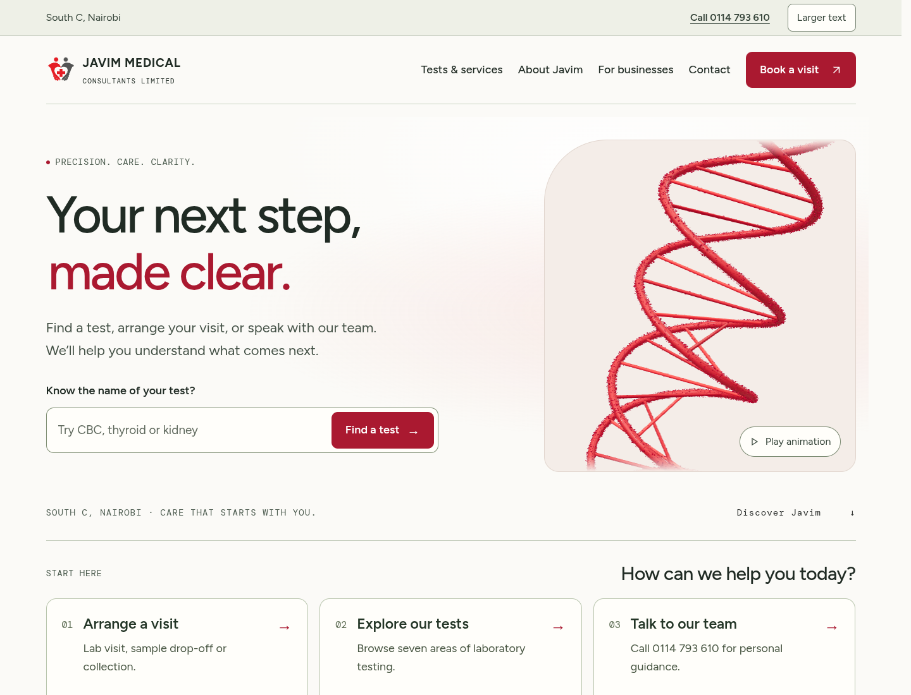

# Design versions

**Update:** the current Design 03 is **Human, by Nature**, replacing the Guided Care draft below. [Review the new Design 03](design-03.md). Design 02 has been redesigned independently as [In Focus](https://github.com/invisibleanalyst/Javim-Medical-Consulting/blob/design/clear-care/docs/design-02.md).

The original website is preserved on `main`. Both alternatives retain the same confirmed contact details, 42 tests, booking choices and general test guidance. No branch is merged or deployed by this change.

| Version | Branch | Direction |
| --- | --- | --- |
| Original | [main](https://github.com/invisibleanalyst/Javim-Medical-Consulting/tree/main) | Original minimalist design and animated scientific scenes |
| Design 02 — In Focus | [design/clear-care](https://github.com/invisibleanalyst/Javim-Medical-Consulting/tree/design/clear-care) | Editorial composition, a red search band and an interactive service index |
| Design 03 — Human, by Nature | [design/guided-care](https://github.com/invisibleanalyst/Javim-Medical-Consulting/tree/design/guided-care) | Human-focused introduction, a photographic service gallery and a dedicated science section |

## Earlier Clear Care draft (superseded)

- Larger body text and readable secondary labels, greater line spacing, darker red and charcoal text.
- Explicit “View tests” card actions; illustrations stay visible without hovering.
- Prominent phone link and a persistent larger-text preference stored locally in the browser.
- Larger focus outlines and controls; responsive navigation opens from a labelled Menu button.
- Scientific scenes start paused, with a visible Play animation label. Users can opt in.
- Warm, light contact section with clearer details.

[Full homepage](screenshots/clear-care/home-full.png) · [Services](screenshots/clear-care/services.png) · [Mobile](screenshots/clear-care/mobile.png)

## Earlier Guided Care draft (superseded)

Built from Clear Care, preserving its readability, contrast, larger-text control and paused scenes.

- A plain-language introduction with a labelled homepage test search.
- Three visible starting choices: arrange a visit, explore tests, or call the team.
- More compact, two-column service cards with smaller supporting illustrations and explicit actions.
- A framed process section with the same three steps, and a quieter catalogue introduction.
- Single-column cards and stacked form controls on small screens; decorative blood cells are omitted on narrow layouts so the search stays clear.

[Full homepage](screenshots/guided-care/home-full.png) · [Services](screenshots/guided-care/services.png) · [Mobile](screenshots/guided-care/mobile.png) · [Service cards](screenshots/guided-care/service-cards.png)

## Validation

Clear Care: production build passed; automated WCAG A/AA scans passed on the homepage, services with expanded test guidance, and privacy. Larger-text persistence, keyboard operation and horizontal bounds were verified at 720, 390 and 320 pixel widths. The 720 pixel layout also approximates the space available when zooming a 1440 pixel desktop window to 200%.

Guided Care: production build, homepage search, booking choices, telephone action, service-detail panel and automated accessibility scans passed. Larger text was checked across homepage, services and privacy at 720, 390 and 320 pixel widths, including persistence after reload.

These checks do not establish complete accessibility compliance or replace usability testing with older adults. Compare the branches with real visitors before choosing a final design.
