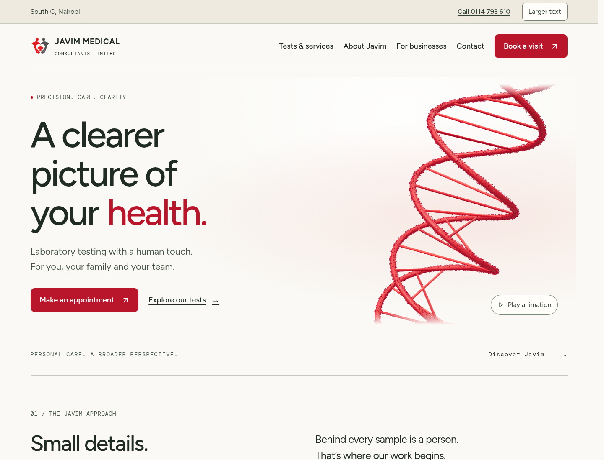

# Design versions

**Update:** `design/clear-care` now contains the new **Design 02 — In Focus**, replacing the early Clear Care version described below. [See the current Design 02](design-02.md). Design 03 is awaiting a separate redesign.

The original website is preserved on `main`. Both alternatives retain the same confirmed contact details, 42 tests, booking choices and general test guidance. No branch is merged or deployed by this change.

| Version | Branch | Direction |
| --- | --- | --- |
| Original | [main](https://github.com/invisibleanalyst/Javim-Medical-Consulting/tree/main) | Original minimalist design and animated scientific scenes |
| Design 02 — In Focus | [design/clear-care](https://github.com/invisibleanalyst/Javim-Medical-Consulting/tree/design/clear-care) | Larger text, explicit controls, stronger contrast and a clear telephone contact |
| Design 03 (earlier draft) | [design/guided-care](https://github.com/invisibleanalyst/Javim-Medical-Consulting/tree/design/guided-care) | Builds on Clear Care with task-based entry points, homepage test search and simplified service discovery |

## Earlier Clear Care draft (superseded)

- Larger body text and readable secondary labels, greater line spacing, darker red and charcoal text.
- Explicit “View tests” card actions; illustrations stay visible without hovering.
- Prominent phone link and a persistent larger-text preference stored locally in the browser.
- Larger focus outlines and controls; responsive navigation opens from a labelled Menu button.
- Scientific scenes start paused, with a visible Play animation label. Users can opt in.
- Warm, light contact section with clearer details.

[Full homepage](screenshots/clear-care/home-full.png) · [Services](screenshots/clear-care/services.png) · [Mobile](screenshots/clear-care/mobile.png)

## Design 03 (awaiting redesign)

Guided Care builds on Clear Care with homepage test search, three task-based starting choices and compact service cards. See its [screenshots and comparison](https://github.com/invisibleanalyst/Javim-Medical-Consulting/blob/design/guided-care/docs/design-versions.md).

## Validation

Clear Care: production build passed; automated WCAG A/AA scans passed on the homepage, services with expanded test guidance, and privacy. Larger-text persistence, keyboard operation and horizontal bounds were verified at 720, 390 and 320 pixel widths. The 720 pixel layout also approximates the space available when zooming a 1440 pixel desktop window to 200%.

These checks do not establish complete accessibility compliance or replace usability testing with older adults. Compare the branches with real visitors before choosing a final design.
